# Manuál 1: Výsledky automatických testů v TestRailu

Tento manuál popisuje, jak se výsledky automatických testů (Robot Framework) dostávají do testů v TestRailu, jak spustit jen vybrané testy a kde výsledky najít. Je psaný pro člověka, který s TestRailem běžně nepracuje.

Ukázkové hodnoty odpovídají cvičné instanci https://vojta1trial.testrail.io, projektu **Notepad – FlaUI** a Jenkins jobu **TestRail-FlaUI-Notepad**. Na jiném projektu se změní jen názvy a čísla.

## 1. Jak to celé funguje

1. V TestRailu se připraví **test run** a do něj se vyberou testy, které se mají spustit.
2. V Jenkinsu se spustí job a zadá se mu **číslo (ID) runu**.
3. Jenkins si z TestRailu přečte, které testy jsou v runu, a spustí **jen tyto testy**.
4. Po doběhnutí nástroj **TRCLI** zapíše výsledky zpět do **stejného runu**. Nevznikají nové testy ani nové runy.

Spojení mezi automatickým testem a testem v TestRailu zajišťuje pole **automation_id**. Musí obsahovat přesnou „cestu“ k testu v Robot Frameworku, například `Tests.Notepad.Zápis textu do editoru - Pozitivní (C19, NOTEPAD002)`.

## 2. Základní pojmy

| Pojem | Význam | Kde ho najdu |
|---|---|---|
| Test case (case) | Popis testu v knihovně testů. Značí se písmenem C, například C19. | Test Cases |
| Test run (run) | Konkrétní spuštění vybraných casů. Značí se R, například R9. | Test Runs & Results |
| Test | Jeden case uvnitř jednoho runu. Značí se T, například T63. Má vlastní výsledky a historii. | Uvnitř runu |
| automation_id | Pole casu, podle kterého se automatický test spáruje s casem. | Detail casu |
| Milestone | Cíl nebo release, pod který runy patří (viz Manuál 2). | Milestones |

## 3. Jednorázové nastavení (dělá správce, už je hotové)

Tato část se dělá jen jednou. Uvádím ji pro úplnost a pro případ, že by se nastavení dělalo znovu na jiné instanci.

### 3.1 Povolení API

1. Vpravo nahoře klikněte na **Admin**.
2. V levém menu zvolte **Site Settings**.
3. Otevřete záložku **API** (ikona mráčku s ozubeným kolem).
4. Zaškrtněte **Enable API**. Volbu „Enable session authentication for API“ nechte vypnutou.
5. Klikněte na **Save Settings**.

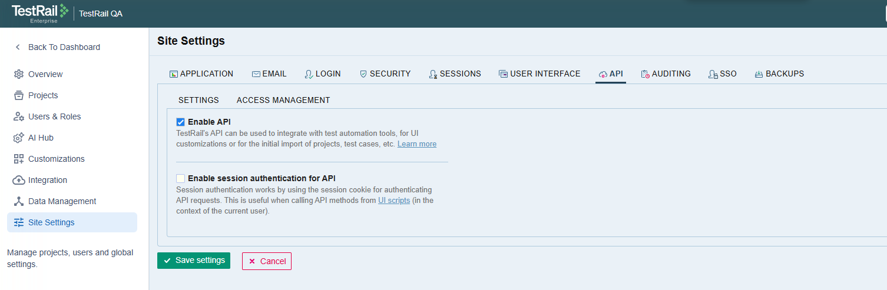
*Obrázek 1: Admin → Site Settings → API, zapnuté Enable API*

### 3.2 Pole automation_id

1. **Admin** → **Customizations** → v části Case Fields klikněte na **Add Field**.
2. **Label:** `automation_id`, **System Name:** `automation_id`.
3. **Type:** `String` (stačí do 250 znaků) nebo `Text` (bez omezení délky).
4. Ponechte zvolené **This field applies to all templates**.
5. Dole klikněte na **Add Projects & Options**, zvolte **All projects** (nebo konkrétní projekt) a potvrďte.
6. Klikněte na **Add Field**.

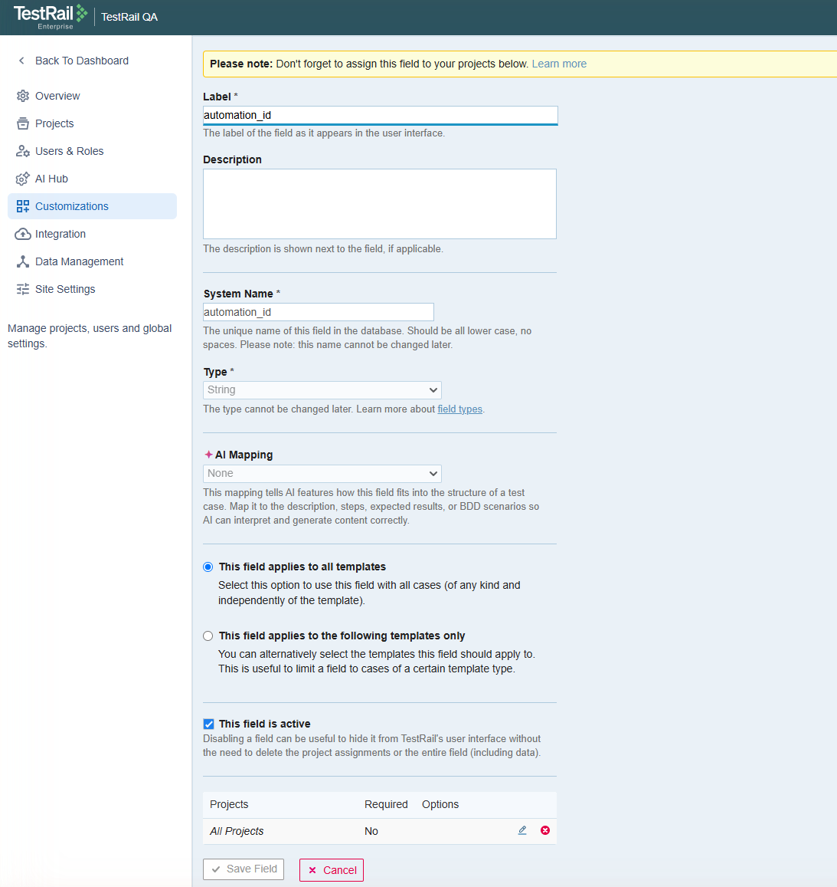
*Obrázek 2: Nastavení pole automation_id (Label, System Name, Type, projekty)*

### 3.3 Šablona s kroky a typ casu

Aby byly u výsledků vidět jednotlivé kroky testu, musí mít automatizované casy šablonu **Test Case (Steps)**.

1. Otevřete **Test Cases** v projektu.
2. Zaškrtněte všechny automatizované casy (čtvereček vlevo u každého řádku).
3. V horní liště klikněte na **Edit** → **Edit selected**.

   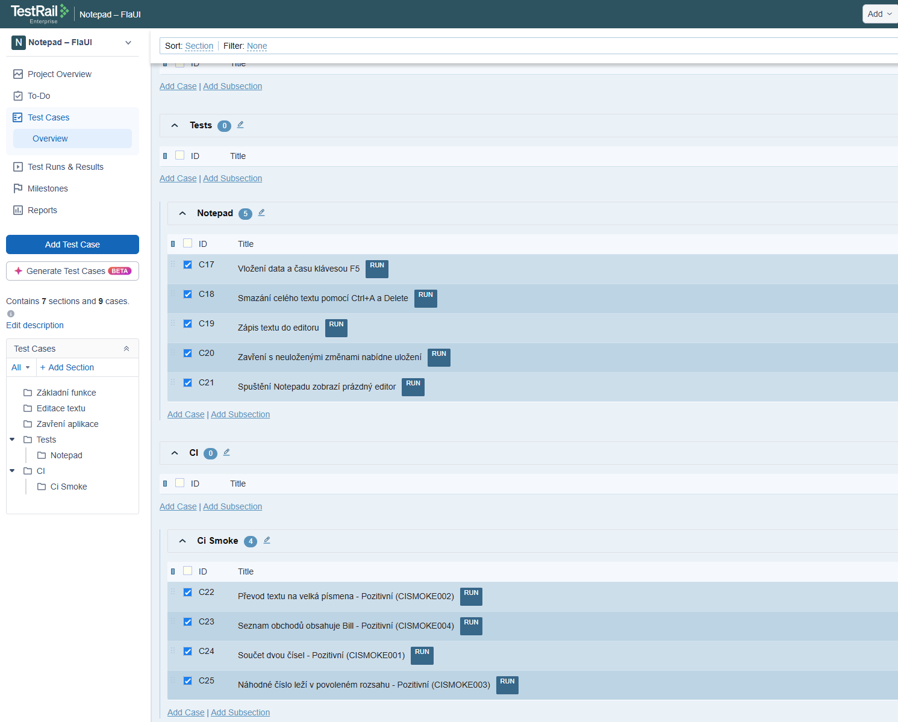
   *Obrázek 3: Test Cases se zaškrtnutými automatizovanými casy*
4. Zaškrtněte políčko u pole **Template** a vyberte **Test Case (Steps)**.
5. Volitelně zaškrtněte i **Type** a vyberte **Automated**, aby šly automatizované testy filtrovat v reportech.
6. Ostatní pole nechte nezaškrtnutá, aby se nezměnila.
7. Klikněte na **Save Test Cases** a potvrďte **Yes, update all … cases**.

   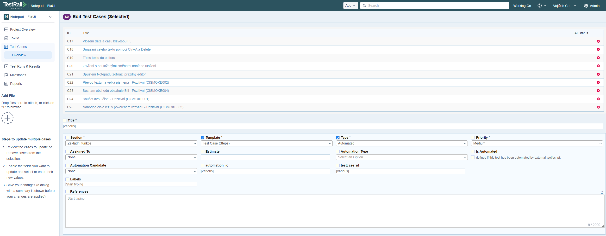
   *Obrázek 4: Hromadná úprava: změní se jen zaškrtnutá pole Template a Type*

### 3.4 API klíč a přihlášení pro Jenkins

1. Vpravo nahoře klikněte na své jméno → **My Settings** → záložka **API Keys**.
2. Klikněte na **Add Key**, zadejte název (například `jenkins-trcli`) a **Generate Key**.
3. Klíč hned zkopírujte (zobrazí se jen jednou) a dole klikněte na **Save Settings**.
4. V Jenkinsu: **Administrace** → **Credentials** → **System** → **Global** → **Add Credentials** → typ **Username with password**. Username = e-mail do TestRailu, Password = API klíč, **ID** = `testrail-api` → **Create**.

Klíč nikdy nevkládejte do kódu, e-mailu ani chatu.

## 4. Postup krok za krokem: spuštění vybraných testů

### 4.1 Připravte test run v TestRailu

1. V projektu otevřete **Test Runs & Results** a klikněte na **Add Test Run**.
2. **Name:** zadejte srozumitelný název, například `Regrese 24. 11. – košík`.
3. **Milestone:** vyberte milestone, ke kterému běh patří (viz Manuál 2).
4. **Assign To:** vyberte sebe nebo nechte prázdné.
5. Dole zvolte **Select specific test cases** a klikněte na **change selection**.

   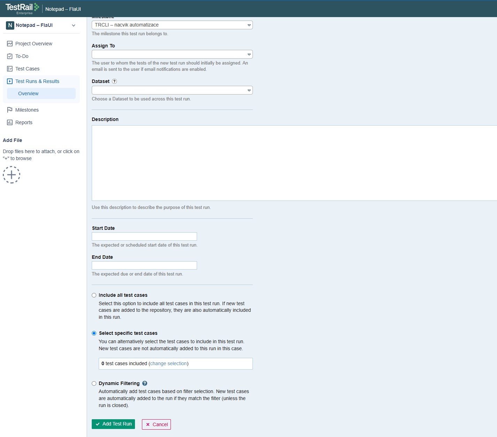
   *Obrázek 5: Formulář Add Test Run s volbou Select specific test cases*
6. V okně **Select Cases**:
   - vlevo jsou sekce (složky). Zaškrtnutím sekce vyberete všechny její testy,
   - kliknutím na název sekce se vpravo zobrazí její testy a můžete zaškrtnout jen některé,
   - nahoře je **Select All / None** pro výběr všeho nebo ničeho.
7. Klikněte na **OK**. Pod volbou se zobrazí počet vybraných testů (například „2 test cases included“).

   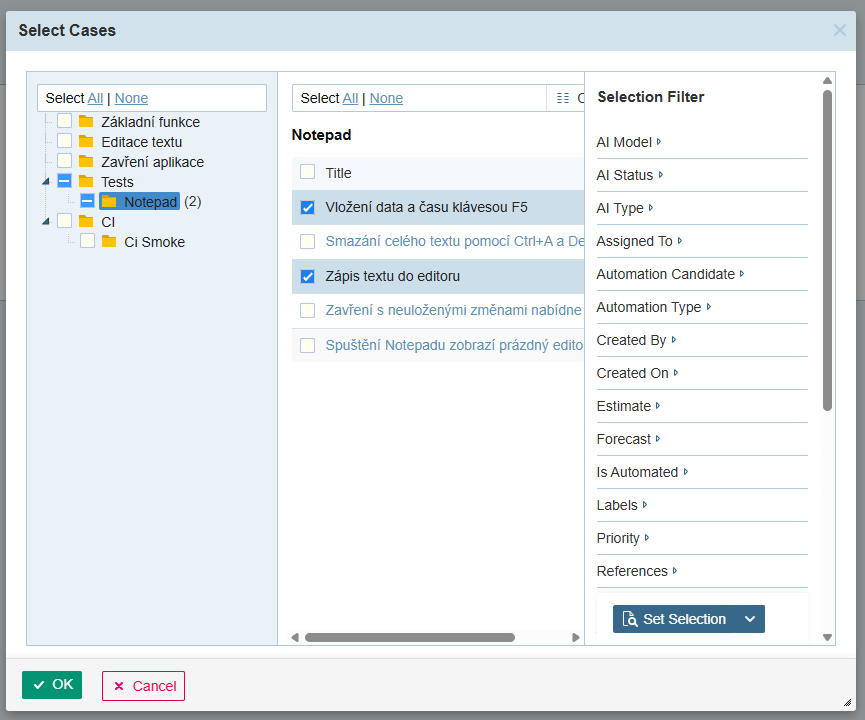
   *Obrázek 6: Okno Select Cases: vlevo sekce, vpravo vybrané testy*
8. Klikněte na **Add Test Run**.
9. **Zjistěte ID runu.** Je v adrese stránky za `runs/view/`, například `…/index.php?/runs/view/9` znamená ID **9**. Stejné číslo je u názvu runu jako R9 (viz obrázek 10 v kapitole 4.4).

Do runu můžete vybrat i manuální testy. Automatizace je přeskočí, protože nemají automation_id.

### 4.2 Spusťte job v Jenkinsu

1. Otevřete Jenkins (u nás http://localhost:8080) a přihlaste se.
2. Klikněte na job **TestRail-FlaUI-Notepad**.
3. Vlevo klikněte na **Build with Parameters**.
4. Do pole **RUN_ID** zadejte ID runu z kroku 4.1 (například `9`). Ostatní parametry nechte na výchozích hodnotách:

| Parametr | Výchozí hodnota | Význam |
|---|---|---|
| RUN_ID | 4 | Run, ze kterého se vyberou testy a kam se zapíší výsledky |
| MILESTONE | 3 | Milestone, ke kterému se run přiřadí |
| TAG | smoke | Informativní značka běhu |
| PROJECT_ID | 2 | Projekt v TestRailu |
| TESTRAIL_PROJECT | Notepad – FlaUI | Přesný název projektu |
| TESTRAIL_HOST | https://vojta1trial.testrail.io | Adresa TestRailu |
| APP_VERSION | 1.0.0 | Verze testované aplikace, zapíše se do pole Version u výsledků |
| REPORT_TEMPLATE_ID | 1 | Report, který se po běhu vygeneruje (viz Manuál 2, kapitola 5). Prázdné = bez reportu |

5. Klikněte na zelené tlačítko **Build**.
6. **Během běhu nesahejte na myš ani klávesnici** počítače, na kterém Jenkins běží. Testy ovládají okna aplikace na ploše.

   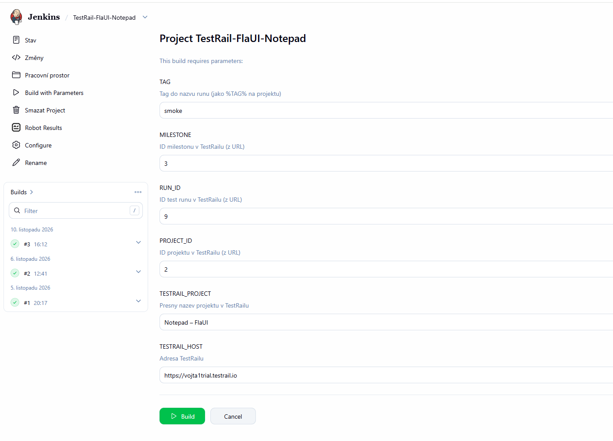
   *Obrázek 7: Jenkins: Build with Parameters s vyplněným RUN_ID*

### 4.3 Sledujte průběh

1. Vlevo dole v **Build History** klikněte na číslo nového buildu (například **#3**).
2. Klikněte na **Console Output**.
3. Ve výpisu hledejte:
   - `Run R9 obsahuje 2 testu` a seznam vybraných testů (řádky začínající `+`),
   - `2 tests, 2 passed, 0 failed` (výsledek Robot Frameworku),
   - `Adding results: 2/2, Done.` (výsledky zapsané do TestRailu),
   - `REPORT_URL=…` a `Odkaz na report pridan do popisu runu` (vygenerovaný souhrnný report),
   - na konci `Finished: SUCCESS`.

   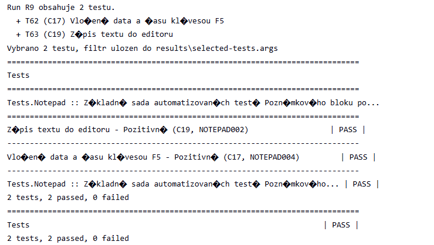
   *Obrázek 8: Výběr testů z runu a výsledek Robot Frameworku*

   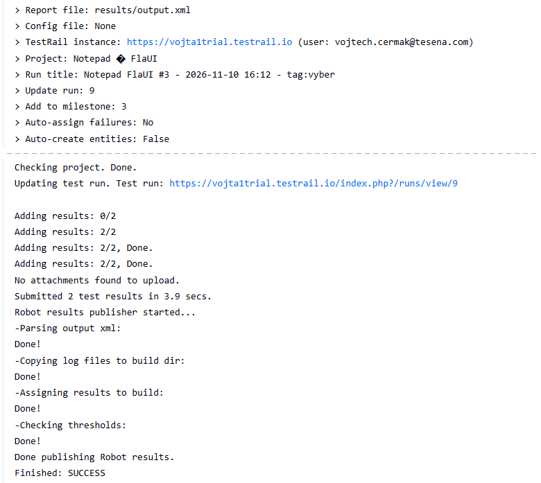
   *Obrázek 9: Nahrání výsledků přes TRCLI a konec buildu*

České znaky se v konzoli Jenkinsu mohou zobrazit rozsypaně (například `Vlo�en�`). Je to jen kosmetická vada kódování konzole, na funkci nemá vliv.

### 4.4 Prohlédněte si výsledky v TestRailu

1. Otevřete run (**Test Runs & Results** → název runu).
2. Nahoře je **koláčový graf** se stavy a procento úspěšnosti, pod ním seznam testů se stavem (Passed, Failed…).

   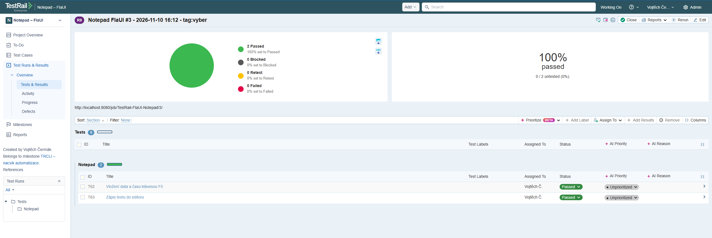
   *Obrázek 10: Run R9: graf stavů, odkaz na build v popisu a oba testy Passed*
3. Klikněte na název testu. V části **Results & Comments** uvidíte:
   - **stav, datum a dobu běhu** (Elapsed),
   - **chybovou hlášku**, pokud test selhal,
   - **screenshot** z okamžiku pádu (náhled, po kliknutí se zvětší),
   - tabulku **kroků testu** se skutečnými hodnotami (díky šabloně Test Case (Steps)),
   - **historii** všech dřívějších výsledků pod sebou. Aktuální stav testu je vždy ten nejnovější.

   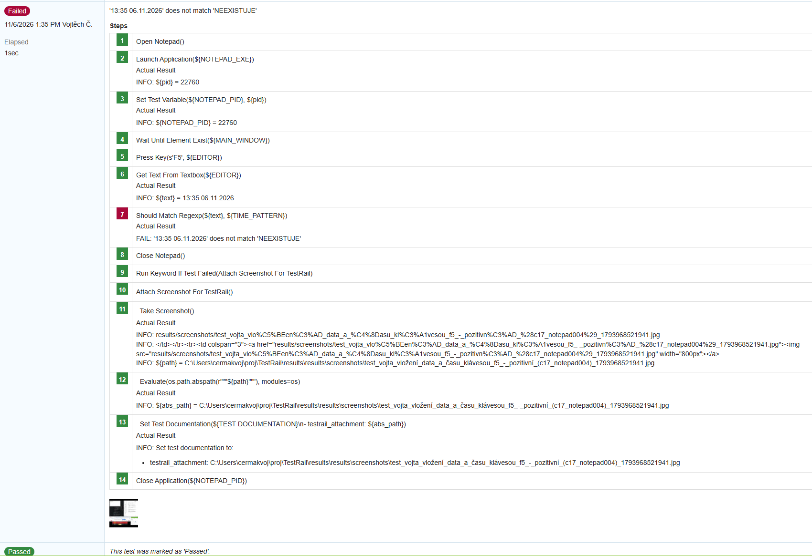
   *Obrázek 11: Detail testu: chybová hláška, kroky se skutečnými hodnotami a náhled screenshotu*
4. V **popisu runu** nahoře jsou dva odkazy: na build v Jenkinsu a na souhrnný report („TestRail report: …“).
5. Stejný odkaz na report je v Jenkinsu jako **popis buildu** v Build History.

## 5. Příkaz TRCLI, kterým se výsledky nahrávají

Výsledky z Robot Frameworku posílá do TestRailu nástroj **TRCLI** (TestRail CLI). Jenkins ho spouští po doběhnutí testů tímto příkazem (hodnoty v `%…%` jsou parametry buildu a přihlašovací údaje z Jenkins credentials):

```
trcli ^
    -n ^
    -h %TESTRAIL_HOST% ^
    --project-id %PROJECT_ID% ^
    --project "%TESTRAIL_PROJECT%" ^
    --insecure ^
    --username "%TESTRAIL_USER%" ^
    --password "%TESTRAIL_API_KEY%" ^
    parse_robot ^
    --run-id %RUN_ID% ^
    --case-matcher auto ^
    --case-fields template_id:2 ^
    --result-fields "version:%APP_VERSION%" ^
    --milestone-id %MILESTONE% ^
    --run-description "%BUILD_URL%" ^
    -f "results/output.xml"
```

S dosazenými hodnotami z cvičné instance vypadá například takto (API klíč je nahrazený zástupným textem):

```
trcli -n -h https://vojta1trial.testrail.io --project-id 2 --project "Notepad – FlaUI" --insecure --username "vojtech.cermak@tesena.com" --password "<API klíč>" parse_robot --run-id 12 --case-matcher auto --case-fields template_id:2 --result-fields "version:1.0.1" --milestone-id 3 --run-description "http://localhost:8080/job/TestRail-FlaUI-Notepad/8/" -f "results/output.xml"
```

| Část příkazu | Význam |
|---|---|
| `-n` | Nic nového nezakládat. Když test nemá odpovídající case, TRCLI skončí bez nahrání výsledků. Opak `-y` povolí založit chybějící sekce a casy, používá se jen jednou při prvním naplnění. |
| `-h` | Adresa TestRailu. |
| `--project-id`, `--project` | ID a přesný název projektu v TestRailu. |
| `--insecure` | Nekontrolovat SSL certifikát serveru (potřeba u serverů s vlastním certifikátem). |
| `--username`, `--password` | E-mail uživatele a jeho **API klíč** místo hesla. V Jenkinsu se berou z credentials `testrail-api`, nikdy se nepíšou přímo do příkazu. |
| `parse_robot` | Číst výstup Robot Frameworku (`output.xml`), včetně kroků testů a příloh. |
| `--run-id` | Run, do kterého se výsledky zapíší. Bez něj by TRCLI založil nový run. |
| `--case-matcher auto` | Párovat testy s casy přes pole **automation_id**. |
| `--case-fields template_id:2` | Šablona Test Case (Steps) pro případné nově zakládané casy, aby byly vidět kroky testu. ID šablony se liší podle instance. |
| `--result-fields "version:…"` | Do každého výsledku zapsat verzi aplikace (pole Version). |
| `--milestone-id` | Přiřadit run k milestonu. |
| `--run-description` | Do popisu runu zapsat odkaz na build v Jenkinsu. |
| `-f` | Cesta k souboru `output.xml` z Robot Frameworku. |

Rozdíly oproti jiným způsobům spuštění:

- **Lokální skript** `run-testrail.ps1` volá stejný příkaz, navíc s `--title "Notepad FlaUI lokalni-beh - <datum čas> - tag:<tag>"` (run se přejmenuje) a bez `--result-fields`.
- **V Jenkinsu se** `--title` **záměrně nepoužívá**, aby si run připravený v TestRailu ponechal svůj název.
- **Na jiném projektu** se příkaz liší hlavně adresou serveru (`-h`), projektem (`--project-id`, `--project`) a případně názvem runu (`--title`).

## 6. Alternativa: spuštění na vlastním počítači

Ve složce repozitáře v PowerShellu (s aktivním `.venv` a nastavenými proměnnými `TESTRAIL_USER` a `TESTRAIL_API_KEY`):

```
.\run-testrail.ps1 -RunId 9 -FromRun
```

Bez `-FromRun` se spustí všechny testy a výsledky se zapíší do zadaného runu.

## 7. Řešení problémů

| Co vidím | Co to znamená | Co udělat |
|---|---|---|
| `V runu neni zadny automatizovany test` | Vybrané casy nemají automation_id, nebo patří jiné sadě testů. | Zkontrolovat výběr runu a pole automation_id u casů. |
| `Found X test cases not matching any TestRail case` a `Exiting` | Název testu v Robot Frameworku se liší od automation_id. Výsledky se **nenahrály**. | Opravit automation_id u casu na přesný název, nebo vrátit název testu. |
| Test je Failed s prázdným textem nebo nesmyslnou hodnotou | Během běhu někdo pohnul myší nebo přepnul okno. | Spustit znovu a během běhu na počítač nesahat. |
| 401 Unauthorized | Špatný e-mail nebo API klíč. | Zkontrolovat credential `testrail-api` a klíč v My Settings → API Keys. |
| Testy se nespustily, okna se neotevřela | Jenkins běží jako služba nebo je zamčená obrazovka. | Jenkins spouštět pod přihlášeným uživatelem, obrazovku nezamykat. |
