# Manuál 2: Reporty, milestony a další vizualizace výsledků

Tento manuál popisuje, jak v TestRailu pracovat s **milestony**, jak nastavit užitečné reporty **Summary → Runs** a **Status Tops** a jaké další možnosti grafického vyjádření výsledků TestRail nabízí (kapitoly 5 až 11). Je psaný pro člověka, který s TestRailem běžně nepracuje.

Ukázkové hodnoty odpovídají cvičné instanci https://vojta1trial.testrail.io a projektu **Notepad – FlaUI**.

## 1. Milestony

Milestone je cíl, ke kterému se testování vztahuje, typicky **release** nebo **sprint**. Runy přiřazené k milestonu se v něm sčítají, takže je vidět celkový stav releasu.

### 1.1 Vytvoření milestonu

1. V projektu klikněte v levém menu na **Milestones** a pak na **Add Milestone**.
2. Vyplňte:
   - **Name:** například `Release 1.0`,
   - **References:** volitelně odkaz na požadavky (například klíč z Jiry),
   - **Parent:** nechte prázdné (vyplňuje se jen u sprintu, viz 1.2),
   - **Description:** stručně, co release obsahuje,
   - **Start Date** a **End Date:** plánovaný začátek a konec.
3. Klikněte na **Add Milestone**.

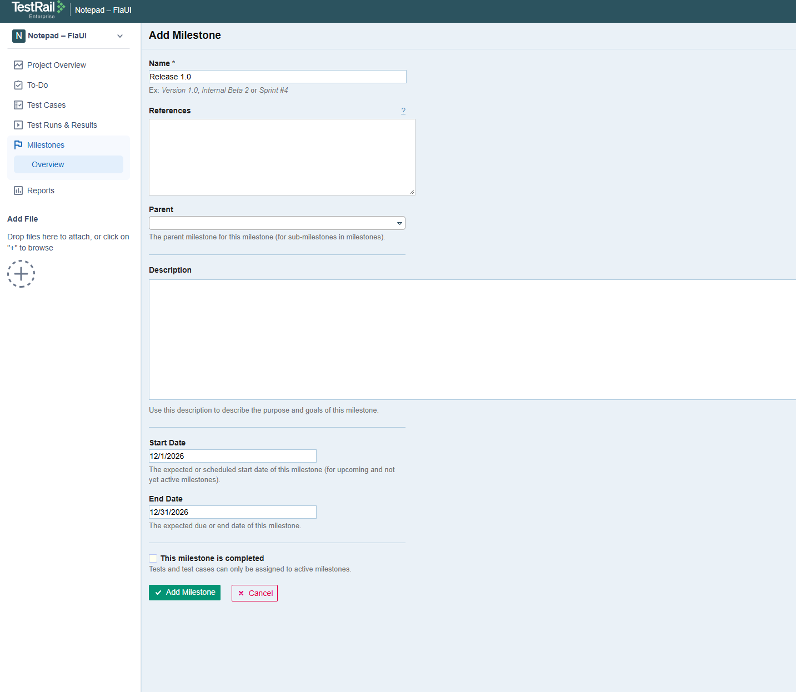
*Obrázek 1: Formulář Add Milestone*

### 1.2 Sprint jako podřízený milestone

1. Znovu klikněte na **Add Milestone**.
2. **Name:** například `Sprint 1`.
3. V poli **Parent** vyberte nadřazený milestone (`Release 1.0`).
4. Doplňte data a klikněte na **Add Milestone**.

Výsledky sprintu se automaticky započítávají i do nadřazeného releasu.

### 1.3 Spuštění milestonu (Start Milestone)

Nový milestone je ve stavu **Upcoming** (připravovaný). Na jeho stránce je žlutá hláška „This milestone hasn't been started yet“. Dokud se nespustí, jsou jeho runy také v sekci Upcoming a nefungují prognózy v záložce Progress.

1. Otevřete **Milestones** a klikněte na název milestonu.
2. Vlevo klikněte na **Start Milestone**.

   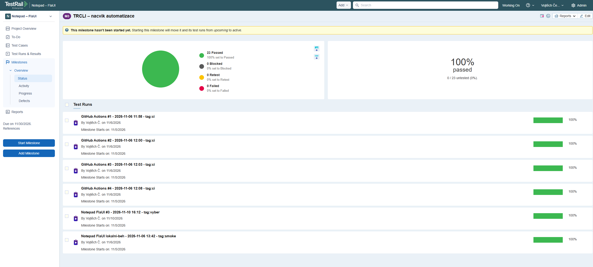
   *Obrázek 2: Nespuštěný milestone: žlutá hláška a tlačítko Start Milestone vlevo*
3. V okně **Start Milestone** zkontrolujte:
   - **Start Date:** skutečné datum začátku. Může být i v minulosti, prázdné pole znamená dnešek,
   - **End Date:** plánované datum konce.

   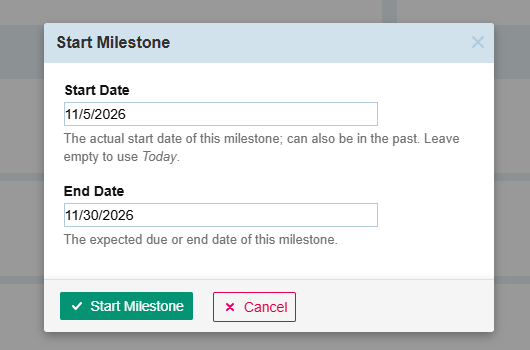
   *Obrázek 3: Potvrzovací okno Start Milestone*
4. Klikněte na **Start Milestone** v okně.
5. Milestone i jeho runy se přesunou mezi **aktivní** (Active / Open).

### 1.4 Přiřazení runu k milestonu

- **Nový run:** při **Add Test Run** vyberte milestone v poli **Milestone**.
- **Existující run:** otevřete run → vpravo nahoře **Edit** → v poli **Milestone** vyberte milestone → **Save Test Run**.
- **Automatické běhy z Jenkinsu:** při **Build with Parameters** zadejte ID milestonu do parametru **MILESTONE**. ID je v adrese stránky milestonu za `milestones/view/` (například `…/milestones/view/3` znamená ID 3).

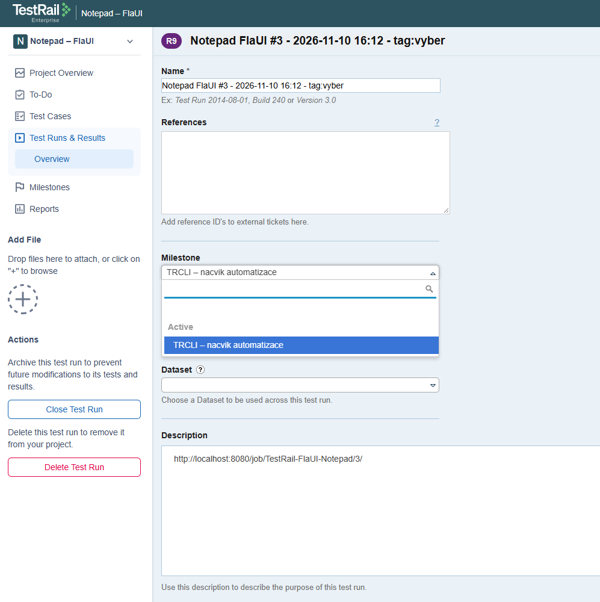
*Obrázek 4: Úprava runu: výběr milestonu v poli Milestone*

### 1.5 Sledování stavu milestonu

Na stránce milestonu jsou v levém menu čtyři pohledy:

| Záložka | Co ukazuje |
|---|---|
| **Status** | Graf stavů (Passed, Failed…) za všechny runy milestonu a procento úspěšnosti. |
| **Activity** | Co se v milestonu dělo v čase (zapsané výsledky po dnech). |
| **Progress** | Vývoj postupu a prognóza dokončení (jen u spuštěného milestonu). |
| **Defects** | Defekty navázané na výsledky. |

Záložku **Status** ukazuje obrázek 2. Záložka **Progress** vypadá takto:

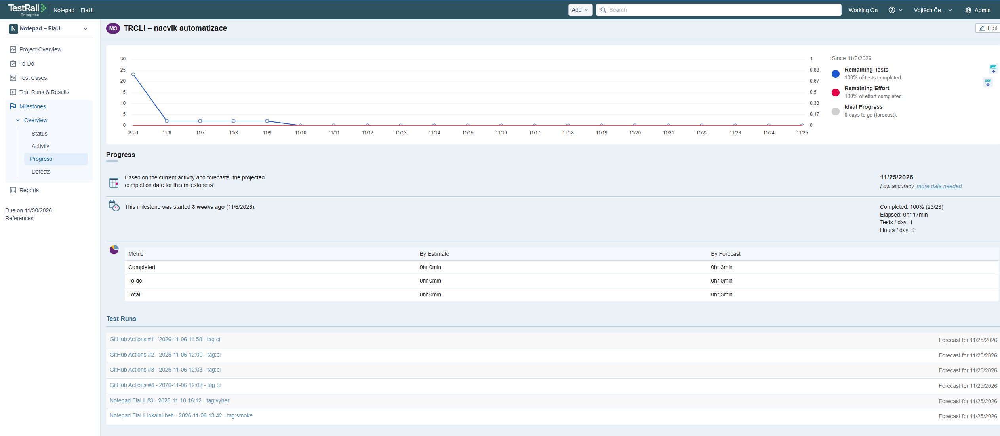
*Obrázek 5: Záložka Progress: graf postupu, prognóza dokončení a odhady*

Data milestonu lze exportovat přes **Export** (CSV, Excel nebo XML) a grafy stáhnout jako obrázek nebo CSV ikonami vpravo od grafu.

### 1.6 Dokončení milestonu

1. Otevřete milestone a klikněte na **Edit**.
2. Zaškrtněte **This milestone is completed**.
3. Klikněte na **Save Milestone**.

Dokončený milestone už nejde znovu otevřít, proto ho uzavírejte až po vyhodnocení releasu.

### 1.7 Doporučení: nový run, nebo jeden opakovaně používaný?

| | Jeden opakovaně používaný run | Nový run pro každý release nebo běh |
|---|---|---|
| Přehled „jak to vypadá teď“ | Jeden run, poslední stav každého testu | Je potřeba otevřít nejnovější run |
| Historie v reportech | Starší výsledky jsou schované uvnitř testů | Výsledky jsou vidět run po runu |
| Doporučené použití | Dlouhodobý regresní run | Pro každý release (milestone) nový run |

Osvědčený kompromis: **pro každý release nový run** pod jeho milestonem, do kterého se během releasu opakovaně zapisuje.

## 2. Report Summary → Runs

Souhrn výsledků za vybrané runy na jednom místě: graf stavů, aktivita v čase, postup a seznam testů. Hodí se jako denní přehled automatických běhů.

1. V projektu klikněte v levém menu na **Reports**.
2. V levém sloupci v panelu **Create Report** najděte skupinu **Summary** a klikněte na **Runs**.

   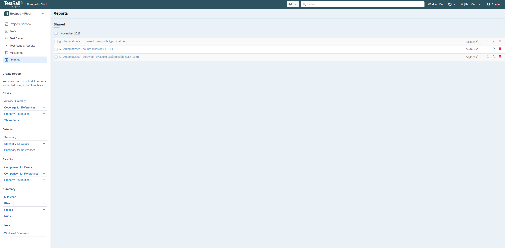
   *Obrázek 6: Stránka Reports: vlevo panel Create Report, vpravo hotové reporty*
3. **Name:** například `Automatizace - souhrn runů`. Do názvu lze vložit proměnnou s datem nebo datem a časem (nápověda je přímo pod polem Name).
4. **Description:** volitelně, k čemu report slouží.
5. Záložka **TEST RUNS** (výběr runů, **povinné**):
   - zvolte **The test runs that match the following filter (now and in the future)** a klikněte na **change**,
   - v okně klikněte na **Milestone**, vyberte milestone a potvrďte **OK**. Pod volbou se zobrazí například „Milestone: Release 1.0“,
   - **Maximum number of test runs to include:** například `10` (bere se od nejnovějších).

   Alternativa: **Only the following test runs** → **Add Test Runs** a výběr konkrétních runů.

   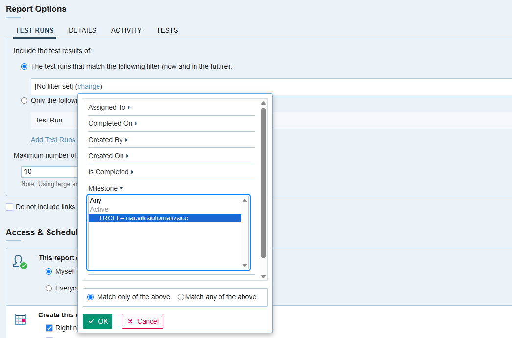
   *Obrázek 7: Okno filtru runů: Milestone a výběr konkrétního milestonu*

   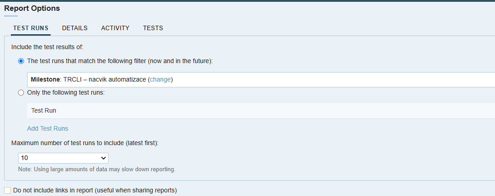
   *Obrázek 8: Záložka TEST RUNS s nastaveným filtrem a maximem runů*
6. Záložka **DETAILS** (co report obsahuje): nechte zaškrtnuté
   - **Status and test statistics** (graf stavů a čísla),
   - **Activity (results over time)** (aktivita v čase),
   - **Progress and remaining estimate/forecast** (postup a prognóza),
   - **Tests and test results** (seznam testů).
7. Záložka **ACTIVITY**: zvolte období a případně jen vybrané stavy. Výchozí období jsou jen poslední dny, takže pokud v nich nepřibyly výsledky, zůstane graf aktivity prázdný. Pro přehled automatizace je lepší delší období, například **This month**.
8. Záložka **TESTS**: volitelně filtr testů, sloupce a maximální počet testů v seznamu.
9. Sekce **Access & Scheduling**:
   - **This report can be accessed by:** **Everyone (with project access)**, aby report viděli i kolegové,
   - **Create this report:** **Right now** (hned), nebo **Schedule this report** (například **Every day** v **07:00**),
   - **Once The Report is Ready:** volitelně upozornění e-mailem, nebo odeslání reportu vybraným uživatelům jako odkaz, HTML nebo PDF příloha.

   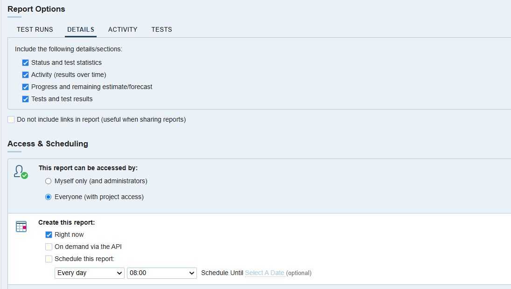
   *Obrázek 9: Záložka DETAILS a nastavení přístupu a plánování*
10. Klikněte na **Add Report**.
11. Hotový report najdete v seznamu **Reports**, otevře se kliknutím na jeho název. Vytvoření trvá několik sekund, případně obnovte stránku.

   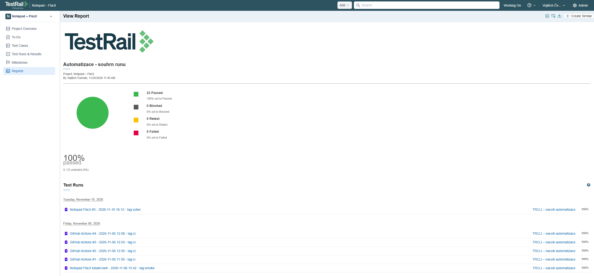
   *Obrázek 10: Hotový Runs Summary: graf stavů a seznam runů*

   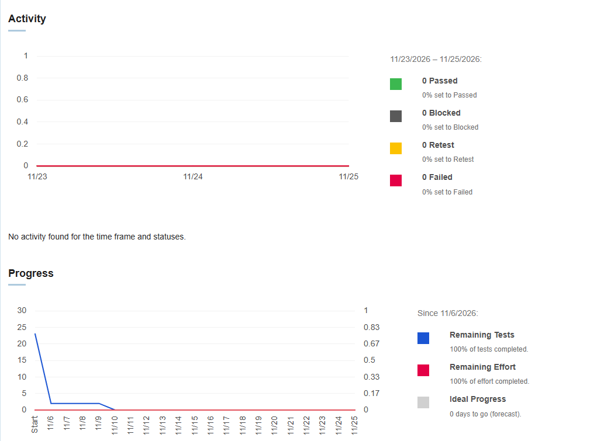
   *Obrázek 11: Sekce Activity a Progress (aktivita je prázdná, protože ve zvoleném období nepřibyly výsledky)*

   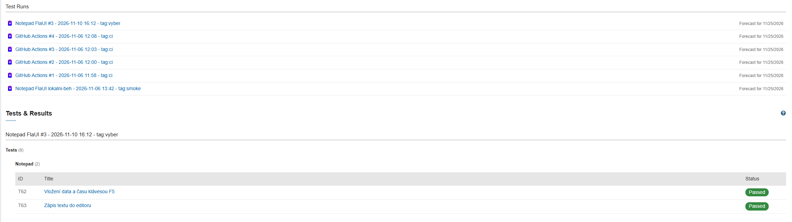
   *Obrázek 12: Sekce Tests & Results: testy v jednotlivých runech a jejich stav*

Pokud se po kliknutí na Add Report objeví hláška **„Please configure a filter for the test runs.“**, není v kroku 5 nastavený filtr runů.

## 3. Report Status Tops

Seznam testů, které nejčastěji končí v určitém stavu, typicky **Failed**. Pomáhá najít nejproblematičtější nebo nestabilní (flaky) testy.

1. **Reports** → v panelu **Create Report** ve skupině **Cases** klikněte na **Status Tops**.
2. **Name:** například `Automatizace - nejčastěji padající testy`.
3. Záložka **STATUSES & RESULTS**:
   - **Include the following statuses:** zvolte **The following statuses only** a v seznamu vyberte **Failed** (více stavů vyberete s klávesou Ctrl, například Failed a Retest),
   - **Include the following results:**
     - **All test results of the tests:** započítá **všechny** výsledky z historie, i když byl test později opraven. Vhodné pro hledání nestabilních testů,
     - **The latest test results per test only (current status):** započítá jen aktuální stav testu.

   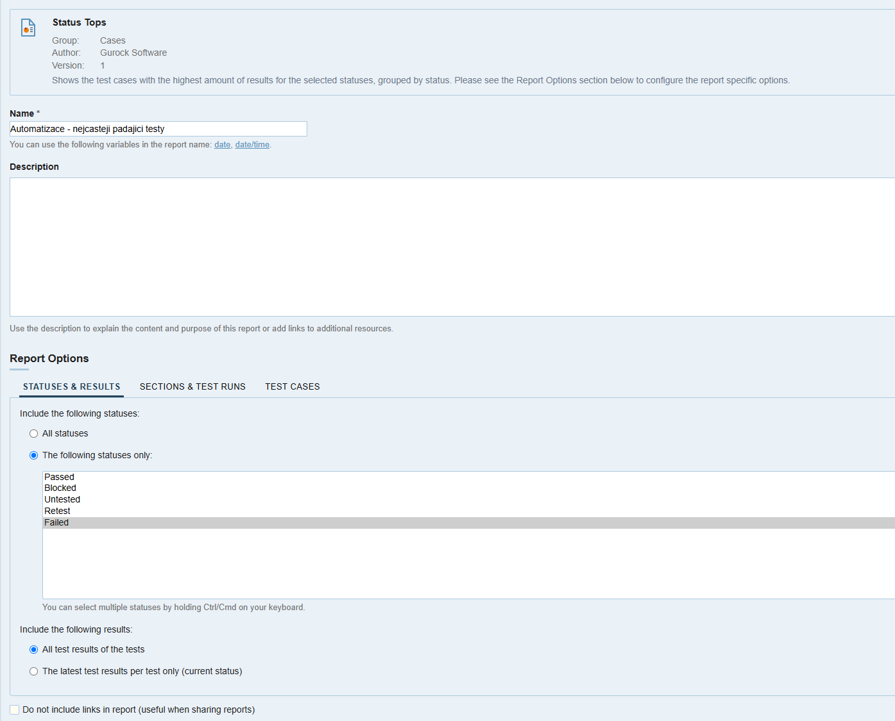
   *Obrázek 13: Status Tops: vybraný stav Failed a započítání všech výsledků*
4. Záložka **SECTIONS & TEST RUNS**:
   - **Include the following sections:** **All sections**, nebo vybrané sekce (například jen automatizované testy),
   - výběr runů stejně jako u Runs Summary: filtr **Milestone** přes **change**, nebo **Only the following test runs**,
   - **Maximum number of test runs:** například `25`.

   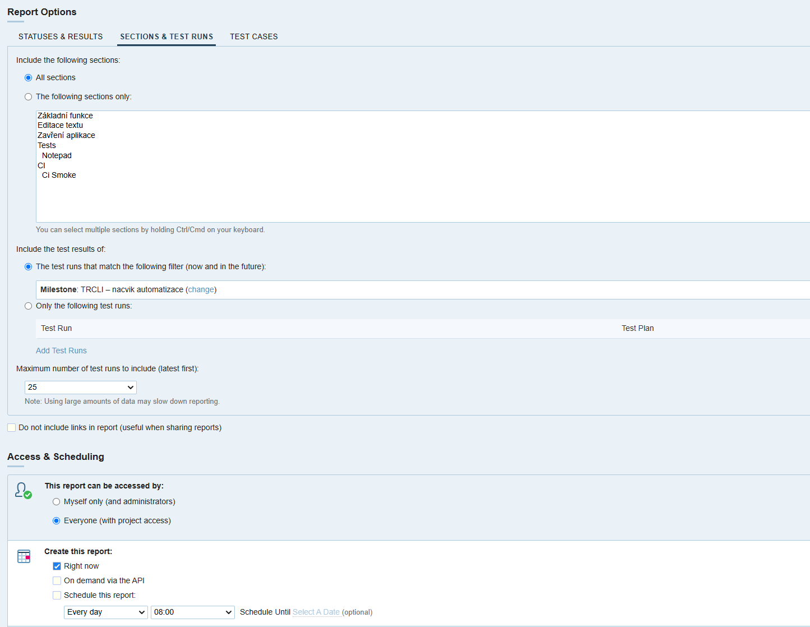
   *Obrázek 14: Status Tops: sekce a filtr runů podle milestonu*
5. Záložka **TEST CASES**: sloupce v tabulce (výchozí ID a Title stačí) a maximální počet casů (například `25`).
6. **Access & Scheduling:** **Everyone (with project access)** a **Right now** nebo plánování.
7. Klikněte na **Add Report**.

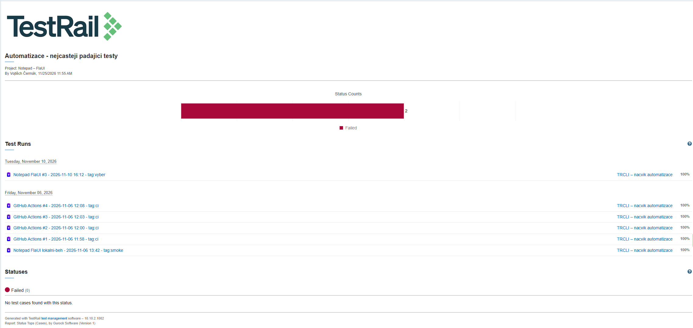
*Obrázek 15: Hotový Status Tops: graf počtu výsledků Failed, runy a seznam casů*

Poznámka z praxe: v ukázce graf ukazuje 2 výsledky Failed, ale tabulka ve spodní sekci Statuses je prázdná. Oba pády byly v opakovaně používaném runu, kde má test dnes stav Passed. Pokud tabulka zůstává prázdná i přes pády v grafu, zkontrolujte výsledek v novém runu nebo použijte report **Comparison for Cases**.

## 4. Plánování a sdílení reportů

- **Pravidelné generování:** v sekci **Access & Scheduling** zaškrtněte **Schedule this report**, zvolte interval (**Every day**, **Every week**, **Every month**) a hodinu. Hodí se například každé ráno po nočním běhu testů.
- **Sdílení mimo TestRail:** volba **Do not include links in report** odstraní z reportu odkazy do TestRailu (vhodné pro posílání lidem bez přístupu).
- **Stejný report znovu s jiným nastavením:** v otevřeném reportu použijte **Create Similar**.

## 5. Report automaticky po každém buildu

Jenkins může po každém běhu testů nechat TestRail vygenerovat souhrnný report a odkaz na něj zapsat do popisu runu v TestRailu i do popisu buildu v Jenkinsu. Stačí jednou připravit report jako **API šablonu**.

### 5.1 Příprava reportu jako API šablony

1. **Reports** → v panelu **Create Report** zvolte šablonu, například **Summary → Runs**.
2. Nastavte report stejně jako v kapitole 2 (název například `API - souhrn runu po buildu`, filtr runů podle milestonu).
3. V sekci **Access & Scheduling**:
   - **This report can be accessed by:** **Everyone (with project access)**,
   - **Create this report:** odškrtněte **Right now** a zaškrtněte **On demand via the API**.
4. Klikněte na **Add Report**. Report se v seznamu objeví jako šablona (bez data vytvoření), ze které se reporty generují až na vyžádání.
5. **Zjistěte ID šablony:** najeďte myší na její název v seznamu, odkaz končí `edit_template/1`, ID je tedy **1**.

### 5.2 Nastavení v Jenkinsu

1. Při **Build with Parameters** zadejte ID šablony do parametru **REPORT_TEMPLATE_ID** (výchozí hodnota je 1).
2. Když report generovat nechcete, nechte parametr prázdný.

### 5.3 Kde odkazy najdete

| Kde | Co tam je |
|---|---|
| TestRail, popis runu | Odkaz na build v Jenkinsu a pod ním „TestRail report: <odkaz>“ |
| Jenkins, Build History | Popis buildu „TestRail report: <odkaz>“ (text ke zkopírování) |
| Jenkins, Console Output | Řádek `REPORT_URL=<odkaz>` |

### 5.4 Co je dobré vědět

- **Report se generuje na pozadí** několik sekund až desítek sekund. Dokud není hotový, odkaz přesměruje na seznam reportů a PDF hlásí **403 - Access Denied**. Stačí chvíli počkat a odkaz otevřít znovu.
- **Odkaz funguje jen přihlášeným uživatelům TestRailu.** Hotový report jde v TestRailu stáhnout jako PDF ikonou stažení vpravo nahoře.
- **Lidem bez přístupu do TestRailu** pošle PDF sám TestRail: v nastavení API šablony zaškrtněte v části **Once The Report is Ready** volbu **Email the report as PDF attachment** a vyplňte adresy.
- **Každý build vytvoří nový report**, v seznamu Reports se proto budou hromadit. Staré reporty občas smažte, případně generujte report jen u nočních nebo release běhů.

## 6. Vlastní stav výsledku (například Flaky)

Kromě stavů Passed, Blocked, Retest a Failed jde přidat vlastní stav s vlastní barvou. Všechny grafy a reporty ho pak ukazují jako samostatnou položku. U automatizace se hodí třeba stav **Flaky** pro nestabilní testy nebo **Skipped** pro přeskočené.

### 6.1 Vytvoření stavu

TestRail nové stavy nevytváří, ale má sedm připravených neaktivních stavů „Unnamed 1“ až „Unnamed 7“, které se přejmenují a zapnou.

1. **Admin** → **Customizations** → v části Statuses klikněte na **Unnamed 1**.
2. Vyplňte:
   - **Label:** `Flaky` (název v TestRailu),
   - **System Name:** `flaky` (identifikátor pro API),
   - **Color (Dark / Medium / Bright):** barvy stavu, například fialová `6b3fa0` / `a77fd6` / `e6dcf5`,
   - **This status is active:** zapnout,
   - **This status is used for executed tests:** zapnout (test proběhl),
   - **This status is a final status:** vypnout (test je potřeba prověřit znovu),
   - **This status is ignored in TestRail metrics:** podle potřeby. Zapnutý stav se nezapočítá do procent úspěšnosti.
3. Klikněte na **Save Status**.

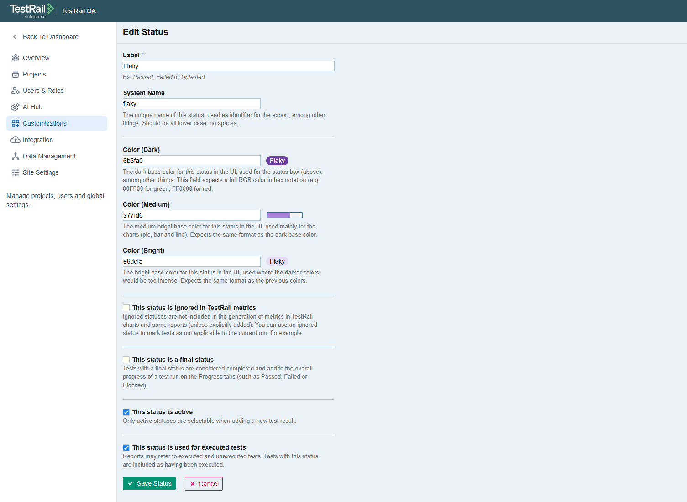
*Obrázek 16: Nastavení vlastního stavu Flaky*

### 6.2 Použití stavu

1. Otevřete test v runu a klikněte na **Add Result**.
2. V poli **Status** vyberte **Flaky**, doplňte komentář a klikněte na **Add Result**.

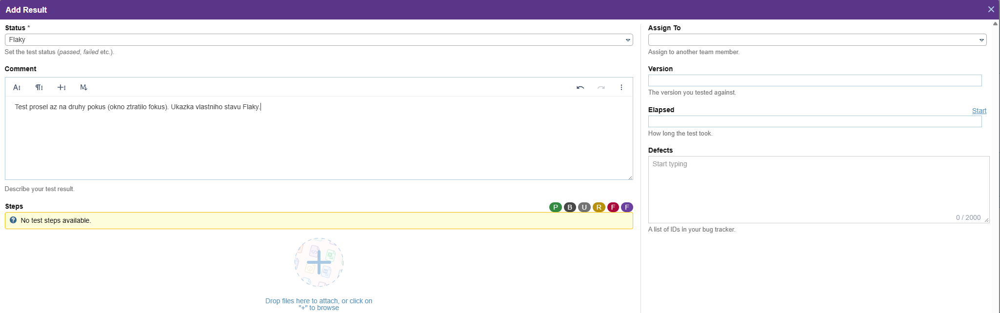
*Obrázek 17: Zápis výsledku se stavem Flaky*

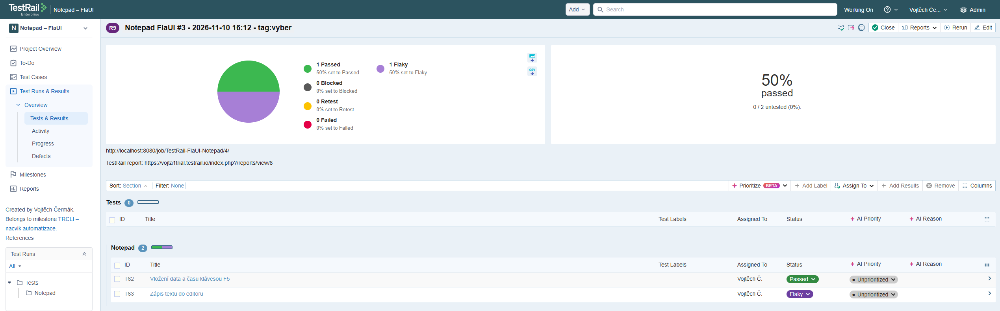
*Obrázek 18: Run s výsledkem Flaky v grafu i v seznamu testů*

### 6.3 Automaticky z Robot Frameworku

- **Jednotlivý test:** TRCLI čte z dokumentace testu řádek `- testrail_result_field: status_id:<ID stavu>` a tímto stavem přepíše výsledek. Test s tagem například `flaky` si ho může v teardownu doplnit, když spadne, a v TestRailu se zapíše jako Flaky místo Failed. ID stavu je v adrese jeho stránky (`…/admin/statuses/edit/6` = ID 6).
- **Hromadně:** v konfiguračním souboru TRCLI (`-c config.yml`) jde přemapovat stavy Robotu na stavy TestRailu (`case_result_statuses`), třeba aby se SKIP zapisoval jako vlastní stav Skipped.

## 7. Test plán s konfiguracemi (stejné testy na více prostředích)

Test plán s konfiguracemi vytvoří ze stejné sady testů samostatný run pro každé prostředí (například SIT a UAT) a ukáže jejich výsledky vedle sebe.

### 7.1 Vytvoření plánu

1. **Test Runs & Results** → vlevo **Add Test Plan**.
2. Vyplňte **Name** (například `Release 1.0 - regrese podle prostredi`) a **Milestone**.
3. Vlevo klikněte na **Add Test Run(s)**. Do plánu se přidá sada testů („Test Run“).
4. U sady klikněte vpravo na **Configurations**.
5. V okně **Select Configurations**:
   - **Add Group** → název skupiny, například `Prostredi`,
   - u skupiny **Add Configuration** → `SIT`, znovu **Add Configuration** → `UAT`,
   - obě konfigurace zaškrtněte a potvrďte **OK**.

   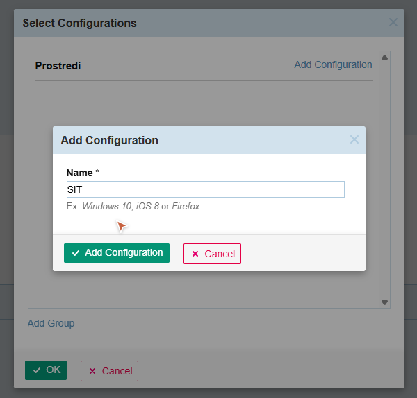
   *Obrázek 19: Přidání konfigurace do skupiny Prostredi*

   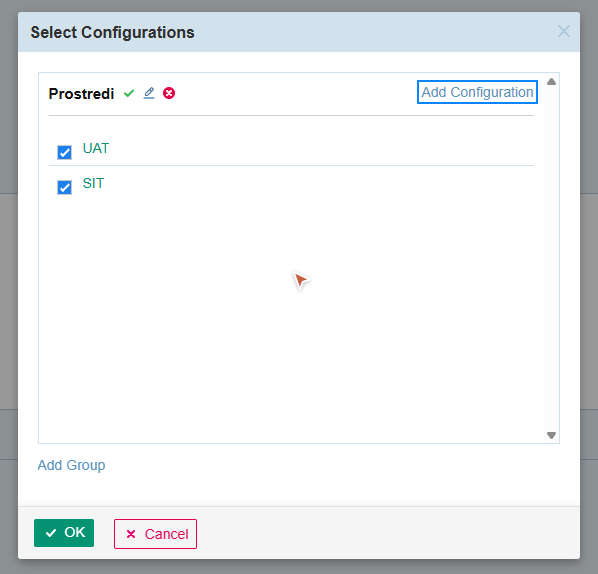
   *Obrázek 20: Vybrané konfigurace SIT a UAT*
6. U sady klikněte na **select cases** a vyberte testy (například jen sekci Notepad). Tužkou vedle názvu sadu přejmenujte (například `Notepad regrese`).
7. Pod sadou je tabulka konfigurací, u každé jde zvlášť změnit výběr testů, přiřazení nebo popis („As above“ = stejné jako sada).
8. Klikněte na **Add Test Plan**.

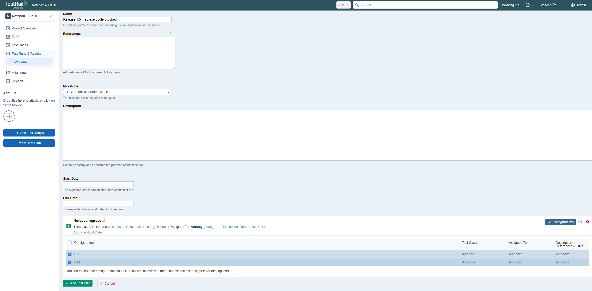
*Obrázek 21: Formulář plánu se sadou testů a konfiguracemi*

### 7.2 Výsledky

Plán obsahuje run pro každou konfiguraci, například **Notepad regrese (SIT)** a **Notepad regrese (UAT)**. Výsledky z Jenkinsu se do nich nahrávají stejně jako do samostatného runu, jen se jako `RUN_ID` zadá ID runu konkrétní konfigurace. Stránka plánu ukazuje souhrnný graf a oba runy pod sebou, takže je hned vidět, na kterém prostředí je problém.

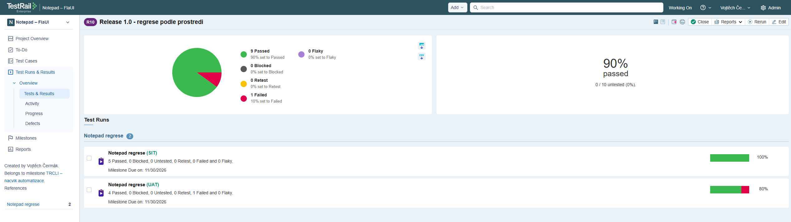
*Obrázek 22: Plán s výsledky po prostředích: SIT 100 %, UAT 80 %*

## 8. Verze aplikace u výsledků

Každý výsledek může nést **verzi testované aplikace** v systémovém poli **Version**. Při analýze pádu je pak hned vidět, ve které verzi test spadl nebo prošel.

- **Ručně:** pole **Version** v okně Add Result.
- **Z Jenkinsu:** parametr buildu **APP_VERSION**. Job ho předá TRCLI přepínačem `--result-fields "version:%APP_VERSION%"`.

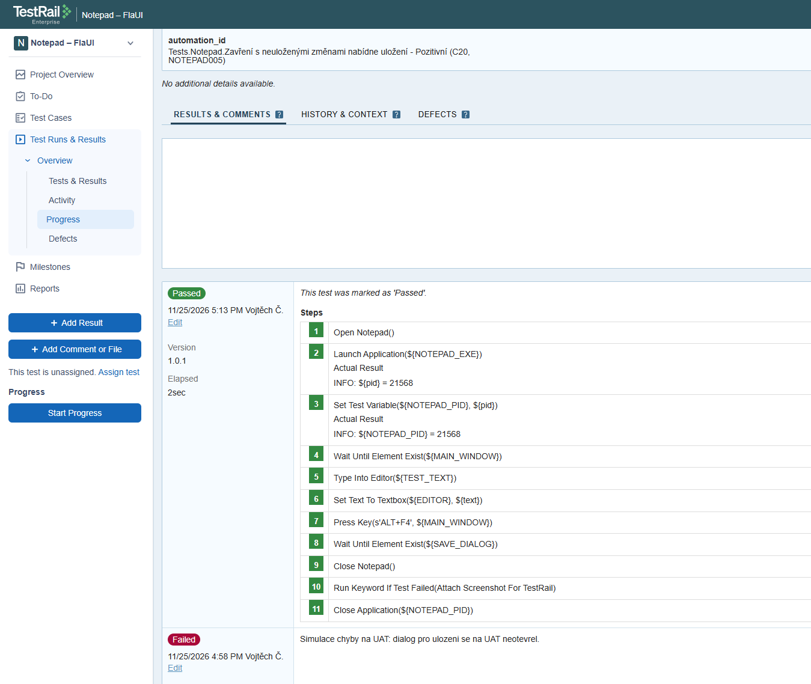
*Obrázek 23: Výsledek s verzí 1.0.1 nad staršími výsledky bez verze*

**Omezení:** reporty TestRailu neumí výsledky seskupit podle verze (Property Distribution nabízí jen pole casů a testů). Pro porovnání verzí použijte samostatný run pro každou verzi (porovná je report Comparison for Cases nebo test plán), nebo export dat přes API do BI nástroje.

## 9. Pokrytí požadavků (References)

Do pole **References** u casu se zapíše identifikátor požadavku, který test ověřuje (například klíč z Jiry). TestRail pak ukáže, které požadavky jsou pokryté testy a jak dopadly.

### 9.1 Vyplnění References

1. Otevřete case a klikněte na **Edit**.
2. Do pole **References** napište identifikátor (například `REQ-102`), více požadavků oddělte čárkou.
3. Klikněte na **Save Test Case**.

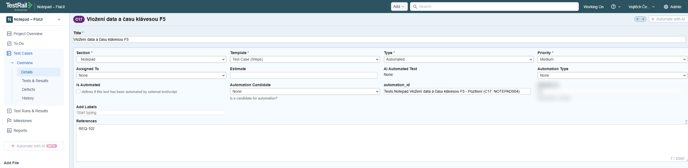
*Obrázek 24: Pole References u casu*

U automatizovaných testů jde References vyplňovat i z Robot Frameworku: TRCLI čte z dokumentace testu řádek `- testrail_case_field: refs:REQ-102`.

### 9.2 Report Coverage for References

1. **Reports** → **Cases** → **Coverage for References**.
2. **Name:** například `Pokryti pozadavku testy`.
3. Záložka **REFERENCES:** **All references**, nebo jen vybrané (jeden na řádek).
4. Záložka **TEST CASES:** zahrnout casy s References i bez nich.
5. **Access:** Everyone → **Add Report**.

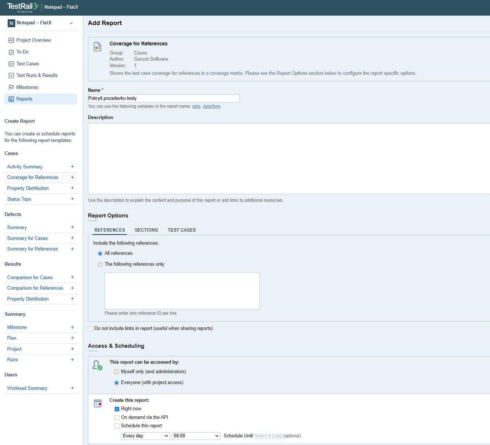
*Obrázek 25: Formulář reportu Coverage for References*

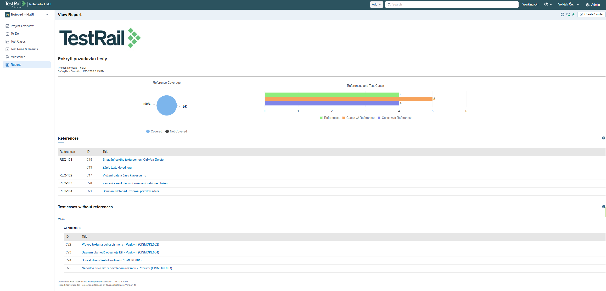
*Obrázek 26: Pokrytí požadavků a casy bez References*

Bez propojení s Jirou zná TestRail jen požadavky zapsané u casů, takže **požadavek bez jediného testu v reportu neuvidí**. Skutečně nepokryté požadavky ukáže až integrace s nástrojem na požadavky.

### 9.3 Report Comparison for References

**Results** → **Comparison for References** ukazuje výsledky testů podle požadavků napříč runy. Nastavuje se stejně jako Runs Summary (filtr runů podle milestonu, sekce).

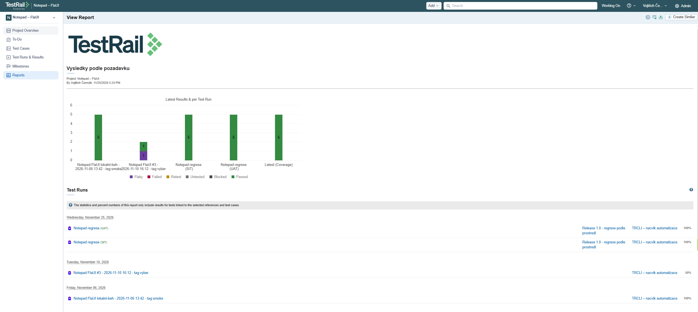
*Obrázek 27: Výsledky runů pro testy navázané na požadavky*

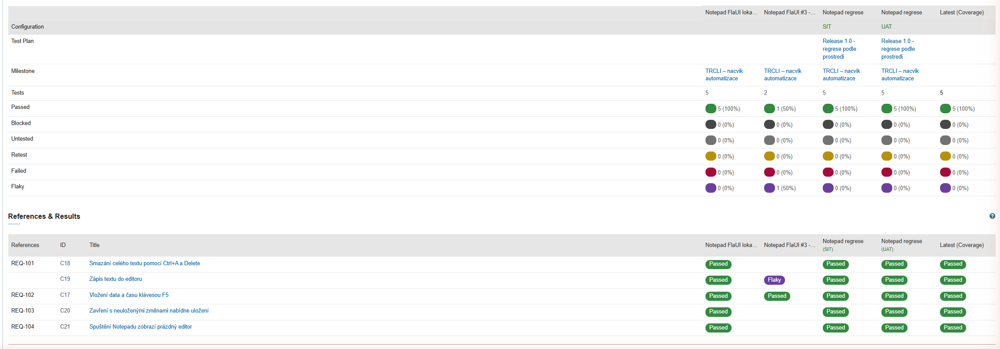
*Obrázek 28: Matice požadavek × run s výsledky*

## 10. Vlastní graf v TestRailu (UI script)

UI scripty vkládají do stránek TestRailu vlastní JavaScript, takže jde přidat graf, který TestRail sám nenabízí. V ukázce je na stránce runu graf úspěšnosti posledních 10 runů. Jeho konfigurace je v repozitáři v souboru `tools/ui-script-trend-runu.txt`.

1. **Admin** → **Site Settings** → **API**: zapnout **Enable session authentication for API** (UI script volá API pod přihlášeným uživatelem). Jde o změnu zabezpečení, v bance o ní rozhoduje správce.
2. **Admin** → **Customizations** → **Add UI Script**.
3. Do **Configuration** vložte konfiguraci (hlavička s názvem a `includes: ^runs/view`, sekce `js:` a `css:`), zaškrtněte **This UI script is active** a klikněte na **Add UI Script**.

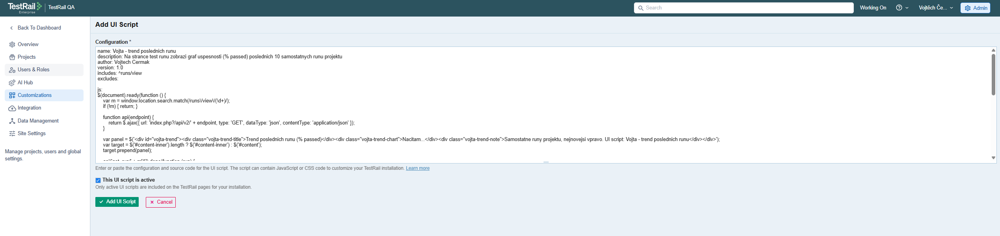
*Obrázek 29: Konfigurace UI scriptu*

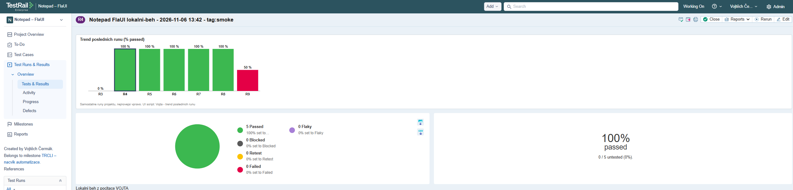
*Obrázek 30: Graf trendu posledních runů na stránce runu*

**Poznámky:** UI script platí pro celou instanci (vidí ho všichni uživatelé). Graf ukazuje jen samostatné runy, runy z test plánů API v tomto výpisu nevrací. Po vypnutí session authentication přestane fungovat, proto ho v tom případě deaktivujte.

## 11. Trend výsledků v Jenkinsu

Robot Framework plugin v Jenkinsu ukazuje na stránce jobu bez dalšího nastavování:

- graf **Robot Framework Tests Trend**: počet prošlých, přeskočených a spadlých testů napříč buildy,
- **Latest Robot Results**: souhrn posledního buildu s odkazy na `report.html` a `log.html`,
- historii buildů s popisem „TestRail report: …“ (viz kapitola 5).

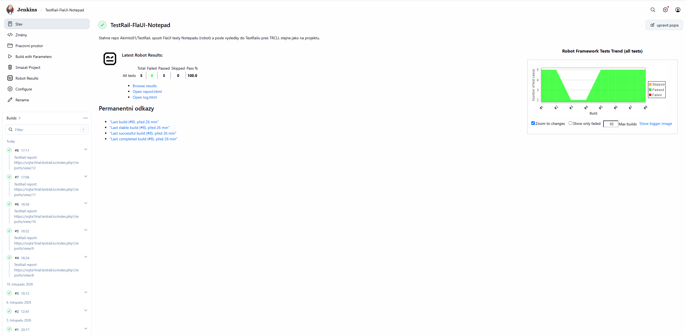
*Obrázek 31: Stránka jobu v Jenkinsu s trendem výsledků*

## 12. Tipy

- Reporty počítají vždy jen s runy, které odpovídají filtru. Když runy správně přiřazujete k milestonům, stačí v reportech filtrovat podle milestonu.
- U opakovaně používaného runu reporty vidí jen poslední výsledek každého testu. Pro hledání nestabilních testů použijte Status Tops s volbou **All test results of the tests**.
- Milestone spusťte (**Start Milestone**) hned na začátku releasu, jinak nefungují prognózy postupu.
